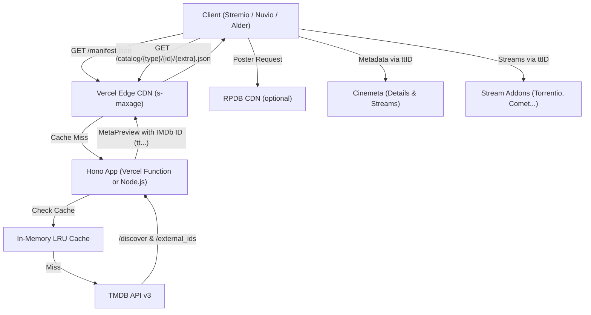

# System Architecture — TMDB Year, Country & Rating Catalog Addon

## 1. Introduction & Overview
This service operates as a high-performance proxy and catalog provider adhering to the **Stremio Addon Protocol v3**. It connects Stremio-compatible clients (official Stremio Desktop/Web/Mobile/TV, Nuvio, Alder) to **TheMovieDB (TMDB)**.

Its core purpose is to solve Stremio's longstanding lack of native multi-criteria filtering by organizing titles by:
1. **Release Year or Decade:** individual years (from current year down to 2020) and ranges/decades (`2015 - 2019`, `2000s`, `90s`, `80s`, `70s`, `Classics (<1970)`).
2. **Production Regions:** Europe, Spain, United States, Latin America, Asia, or worldwide.
3. **TMDB Rating Thresholds:** customizable minimum user scores (`7.0+`, `7.5+`, `8.0+`, `8.5+`, or any).
4. **Natural Language Search:** smart search queries parsed on the fly (`2023 8+`, `dune 2024`, `year:2021 rating:7.5`).
5. **Rating Badges (RPDB):** optional integration with RatingPosterDB to stamp scores directly onto poster artwork.

---

## 2. Deployment Architecture

| Environment | Entrypoint | Notes |
| :--- | :--- | :--- |
| **Vercel** (recommended) | `src/app.ts` (`export default app`) | Zero-config Hono detection. Routes execute as Vercel Functions. Vercel Edge CDN caches responses using `s-maxage`. |
| **Node / Docker / VPS** | `src/node.ts` → `dist/node.js` | Uses `@hono/node-server`, graceful shutdown on SIGTERM/SIGINT, Docker `HEALTHCHECK`. |

All assets (web configuration UI and embedded 256x256 PNG logo) are compiled directly into TypeScript modules, requiring zero disk reads in serverless runtimes.

---

## 3. Data Flow Diagram

---

## 4. Stremio Protocol Specification

### 4.1 Manifest (`GET /manifest.json`, `GET /:config/manifest.json`)
* Declares `resources: ['catalog']` and types (`movie`, `series`).
* `behaviorHints.configurable: true` enables the native "Configure" button in Stremio.
* Generates clean catalog names (`Top Movies`, `Top Series`) without emojis to match native UI styling.

### 4.2 Catalogs (`GET /catalog/:type/:id/:extra?.json`)
* **ID Resolution:** every title from TMDB is resolved to an IMDb ID (`tt...`) using TMDB `/external_ids` with LRU caching.
* **Pagination:** compliant with `stremio-core` block requests (`skip = count of received items`), serving blocks of 100 titles.
* **Release Info:** formatted as `${year} · TMDB ${rating}` without misleading IMDb rating badges.
* **Genres:** mapped from official TMDB genre IDs to bilingual tags.

---

## 5. Caching Strategy

1. **In-Memory LRU Cache:**
   * Catalogs: 6-hour TTL indexed by normalized query parameters, language, and RPDB key.
   * TMDB ID ➔ IMDb ID mapping: 7-day TTL (immutable identifier mappings).
2. **HTTP CDN Caching (`s-maxage`):**
   * Full catalog responses: 6 hours on CDN, 30 minutes in client.
   * `stale-while-revalidate` and `stale-if-error`: 24 hours.
   * Transient/empty responses: 5 minutes.
