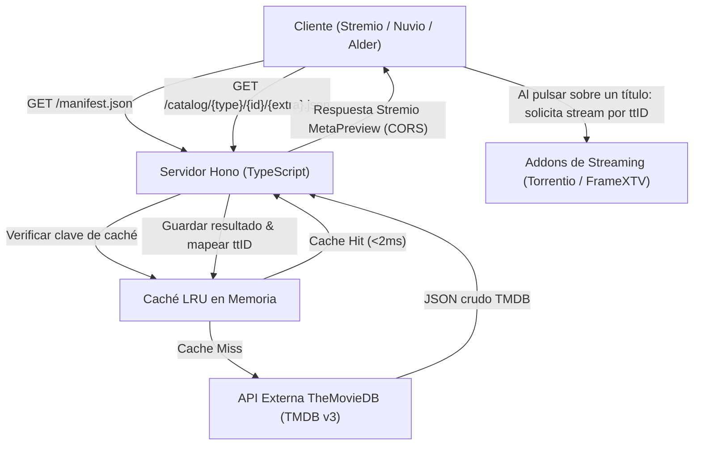

# Arquitectura del Sistema - IMDb & Year Filter Catalog Addon

## 1. Introducción y Propósito
El objetivo de este componente es actuar como un intermediario de alto rendimiento entre los clientes compatibles con Stremio (Stremio Oficial, Nuvio, Alder) y las fuentes de metadatos cinematográficos (TheMovieDB API).

Su misión fundamental es permitir la exploración y descubrimiento de películas y series cruzando dos dimensiones habitualmente no combinables en los catálogos por defecto:
1. **Calidad crítica / Puntuación de usuarios** (IMDb / TMDB Rating).
2. **Año o época de estreno** (Año exacto o rango por décadas).

---

## 2. Flujo de Información y Comunicación



---

## 3. Especificación del Protocolo Stremio v3

El servidor expone las siguientes rutas HTTP cumpliendo estrictamente con la especificación REST de Stremio:

### 3.1. `GET /manifest.json` y `GET /:config/manifest.json`
Retorna el manifiesto del addon.
* Si se llama a `/manifest.json`, entrega los catálogos por defecto (ej. *Top Valoradas Recientes*, *Lo mejor por Año*, etc.).
* Si se llama a `/:config/manifest.json`, descodifica la configuración personalizada del usuario (parámetros codificados en Base64/JSON) y genera un manifiesto dinámico con los catálogos elegidos por el usuario.

**Estructura del catálogo en el Manifiesto:**
```json
{
  "id": "imdb_year_movies",
  "type": "movie",
  "name": "Explorador por Nota y Año",
  "extra": [
    {
      "name": "genre",
      "isRequired": false,
      "options": [
        "⭐ IMDb 8.0+",
        "⭐ IMDb 7.5+",
        "⭐ IMDb 7.0+",
        "📅 2025",
        "📅 2024",
        "📅 2023",
        "📅 2020-2022",
        "📅 Década 2010",
        "📅 Década 2000",
        "📅 Años 90",
        "📅 Clásicos (<1990)"
      ]
    },
    {
      "name": "search",
      "isRequired": false
    },
    {
      "name": "skip",
      "isRequired": false
    }
  ]
}
```

### 3.2. `GET /catalog/:type/:id/:extra?.json`
Manejador principal de solicitudes de catálogo.
* **`type`**: `movie` o `series`.
* **`id`**: Identificador del catálogo definido en el manifiesto.
* **`extra`**: Cadena formateada de parámetros opcionales codificados en URL (ej. `genre=⭐ IMDb 8.0+&skip=20` o `search=2023 8+`).

**Formato de respuesta:**
```json
{
  "metas": [
    {
      "id": "tt1283515",
      "type": "movie",
      "name": "Título de la Película",
      "poster": "https://image.tmdb.org/t/p/w500/...",
      "description": "Sinopsis de la película...",
      "releaseInfo": "2024",
      "imdbRating": "8.4",
      "genres": ["Drama", "Ciencia ficción"]
    }
  ]
}
```

### 3.3. `GET /configure`
Página web HTML/JS servida directamente por el backend. Permite al usuario:
* Escoger qué géneros prefiere.
* Seleccionar los filtros predeterminados que quiere tener fijados en su pantalla de inicio.
* Configurar el umbral de votos mínimos (ej. *mínimo 300 votos* para evitar títulos con notas ficticias).
* Generar el botón de instalación directa `stremio://...`.

---

## 4. Mapeo de Identificadores (TMDB ID ➔ IMDb ID)
Para que los títulos descubiertos en este catálogo puedan ser reproducidos por addons como **Torrentio**, **Comet** o el futuro **Addon de FrameXTV**, es imperativo que el campo `id` del objeto `MetaPreview` contenga el formato estándar de IMDb (`tt1234567`).

* **Estrategia:**
  1. Durante la consulta a TMDB Discover, se obtienen los `id` de TMDB.
  2. Mediante el endpoint `/movie/{id}/external_ids` o `/tv/{id}/external_ids`, se extrae el campo `imdb_id`.
  3. Para evitar latencia múltiple en paralelo, se utiliza una **caché de IDs persistente/en memoria** que almacena las equivalencias `tmdb:12345` ➔ `tt67890`.

---

## 5. Estrategia de Caché de Alto Rendimiento

Para cumplir con el límite de cuotas de TheMovieDB y garantizar una experiencia instantánea en clientes de TV y móvil, se implementa una caché **LRU (Least Recently Used)** en dos capas:

1. **Caché de Catálogo (TTL: 6 a 12 horas):**
   * Almacena el resultado JSON completo de una consulta (ej. `movie:catalog_8_plus:page_1`).
   * Como las valoraciones de películas y series ya estrenadas cambian lentamente, un TTL de varias horas reduce en más del 95% las llamadas a la API externa.
2. **Caché de Identificadores (TTL: 7 días):**
   * Almacena las asociaciones `tmdb_id` ➔ `imdb_id`. Esta relación es inmutable.
