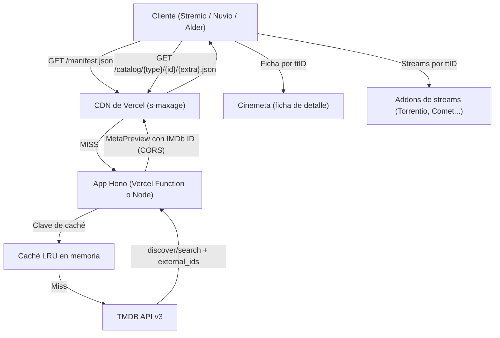

# Arquitectura del Sistema - IMDb & Year Filter Catalog Addon

## 1. Introducción y Propósito
Este componente actúa como intermediario de alto rendimiento entre los clientes compatibles con Stremio (Stremio oficial, Nuvio, Alder) y TheMovieDB (TMDB API v3).

Resuelve la limitación de la interfaz de Stremio (un único desplegable por catálogo) organizando el contenido en **catálogos temáticos**:
1. **Por país de origen:** España, EE. UU., Japón, Corea, Reino Unido, Francia, nórdicos… prefiltrados por buena nota.
2. **Por año o época:** años individuales (desde 2020 hasta el año en curso, generados dinámicamente) y rangos/décadas.
3. **Por puntuación:** cortes 8.5+, 8.0+, 7.5+, 7.0+.
4. **Búsqueda inteligente:** catálogos exclusivos del buscador con sintaxis natural (`2023 8+`, `dune 2024`).

---

## 2. Despliegue

| Entorno | Punto de entrada | Notas |
| :--- | :--- | :--- |
| **Vercel** (recomendado) | `src/app.ts` (`export default app`) | Detección *zero-config* de Hono. Cada ruta se ejecuta como Vercel Function (Fluid compute). La CDN de Vercel cachea las respuestas según `s-maxage`. |
| **Node / Docker / VPS** | `src/node.ts` → `dist/node.js` | `@hono/node-server`, cierre ordenado con SIGTERM, `HEALTHCHECK` en Docker. |

Todos los recursos (HTML de configuración y logo PNG) se distribuyen como módulos TypeScript, sin lecturas de disco, para que el bundle sea autocontenido en cualquier runtime.

---

## 3. Flujo de Información

---

## 4. Especificación del Protocolo Stremio v3

### 4.1. `GET /manifest.json` y `GET /:config/manifest.json`
* `resources: ['catalog']`, `types` calculados a partir de los catálogos activos.
* **Sin `idPrefixes`:** al ser un addon solo de catálogo, Stremio delega la ficha (`meta`) en Cinemeta.
* `logo`: URL absoluta a `/logo.png` (PNG 256×256, formato recomendado por Stremio), construida con `PUBLIC_URL` o con las cabeceras `x-forwarded-*` de la petición.
* `behaviorHints.configurable: true` → Stremio muestra el botón *Configurar*, que abre `/configure` (o `/:config/configure` si el addon ya está configurado).
* `version` se define en `ADDON_VERSION` (`src/routes/manifest.ts`); incrementarla cuando cambie el manifiesto para que los clientes detecten la actualización.

**Catálogos** (registro único `CATALOG_SPECS`, compartido con la ruta de catálogo):

| ID | Tipo | Extra |
| :--- | :--- | :--- |
| `imdb_country_movies` / `imdb_country_series` | movie / series | `genre` (países), `skip` |
| `imdb_year_movies` / `imdb_year_series` | movie / series | `genre` (años/épocas), `skip` |
| `imdb_rating_movies` / `imdb_rating_series` | movie / series | `genre` (notas), `skip` |
| `imdb_search_movies` / `imdb_search_series` | movie / series | `search` (**obligatorio**), `skip` |
| `top_movies_8` / `top_series_8` (opcionales) | movie / series | `skip` |
| `recent_releases` (opcional) | movie | `skip` |

La búsqueda solo se declara en los catálogos `imdb_search_*` con `isRequired: true`: así aparecen únicamente en el buscador y no se generan filas duplicadas ni filas vacías en el tablero.

**Valores por defecto sin `genre`** (fila del tablero): país → España; año → año en curso; nota → mejor valoradas de todos los tiempos.

### 4.2. `GET /catalog/:type/:id/:extra?.json`
* El segmento `extra` se lee de la **ruta cruda** (sin decodificar) y se separa por `&` antes de decodificar cada valor, de modo que una búsqueda como `fast%20%26%20furious` no se rompe.
* **Paginación:** stremio-core pide la página siguiente con `skip` = suma de títulos ya recibidos y deja de paginar cuando una página llega vacía. El addon devuelve bloques de hasta **100 títulos** (5 páginas de TMDB). El bloque se calcula como `round(skip / 100)`, lo que absorbe los pocos títulos descartados por no tener IMDb ID.
* **Filtro de estrenos:** la fecha máxima nunca supera hoy, para no mostrar títulos aún no estrenados (sin streams).
* **Países múltiples** (nórdicos): TMDB admite OR con `|` en `with_origin_country` (`SE|NO|DK|FI`).
* **Respuesta:** `{ metas, cacheMaxAge, staleRevalidate, staleError }` + cabecera `Cache-Control` con `s-maxage`.
* **Errores de TMDB:** respuesta `{ metas: [] }` con `Cache-Control: no-store` (nunca se cachea un fallo).

### 4.3. `GET /configure` y `GET /:config/configure`
Página HTML/JS servida por el backend:
* Clave TMDB propia (v3 o token v4), votos mínimos y catálogos activos.
* Precarga la configuración existente leyendo el segmento Base64 de la URL.
* Genera enlaces `stremio://…`, `https://web.stremio.com/#/addons?addon=…` y la URL del manifiesto para Nuvio.

### 4.4. Configuración de usuario (`:config`)
JSON en Base64URL validado en `decodeConfig` (`src/types/config.ts`): tamaño máximo 2 KB, booleanos estrictos, votos acotados (1-5000 / 1-2000) y clave TMDB restringida a `[A-Za-z0-9_.-]`. Si el usuario no fija los votos mínimos se aplican `DEFAULT_MIN_VOTES_*` del servidor.

---

## 5. Mapeo de Identificadores (TMDB ID ➔ IMDb ID)
El campo `id` de cada `MetaPreview` debe ser un IMDb ID (`tt1234567`) para que Cinemeta abra la ficha y los addons de streams encuentren enlaces.

1. TMDB discover/search devuelve IDs de TMDB.
2. Se consulta `/movie/{id}/external_ids` o `/tv/{id}/external_ids` con **concurrencia limitada** (10 peticiones simultáneas) y reintentos ante 429/5xx.
3. Las equivalencias se guardan en caché 7 días.
4. Los títulos sin IMDb ID se descartan. Si alguna resolución falla de forma transitoria, el bloque se marca como incompleto: no se guarda en la caché en memoria y se sirve con una caché HTTP corta (5 min).

---

## 6. Estrategia de Caché

| Capa | TTL | Alcance |
| :--- | :--- | :--- |
| LRU de catálogos | 6 h | Por instancia. La clave no incluye la API key (los resultados no dependen de ella). |
| LRU de IMDb IDs | 7 días | Por instancia. |
| CDN de Vercel (`s-maxage`) | 6 h + 24 h `stale-while-revalidate` | Global, compartida entre instancias. Imprescindible en serverless, donde la memoria es efímera. |
| Cliente (`max-age`, `cacheMaxAge`) | 30 min | Stremio / Nuvio. |

Resultados vacíos o incompletos: 5 min. Errores: `no-store`.
