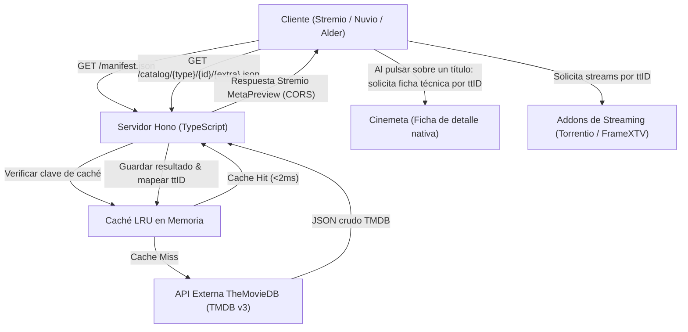

# Arquitectura del Sistema - IMDb & Year Filter Catalog Addon

## 1. Introducción y Propósito
El objetivo de este componente es actuar como un intermediario de alto rendimiento entre los clientes compatibles con Stremio (Stremio Oficial, Nuvio, Alder) y las fuentes de metadatos cinematográficos (TheMovieDB API).

Su misión fundamental es resolver la limitación de la interfaz de Stremio (que solo permite un menú desplegable por catálogo) organizando el contenido en **catálogos temáticos específicos y coherentes**:
1. **Catálogos por País de Origen:** Selección directa de cinematografías mundiales (España, EE.UU., Japón, Corea, Reino Unido, Francia, etc.) prefiltradas por buena nota.
2. **Catálogos por Año o Época:** Selección de años concretos (2025, 2024...) o décadas (Años 90, Años 80, Clásicos) con lo mejor de cada periodo.
3. **Catálogos por Puntuación IMDb:** Cortes de calidad crítica (IMDb 8.5+, 8.0+, 7.5+, 7.0+).

---

## 2. Flujo de Información y Comunicación



---

## 3. Especificación del Protocolo Stremio v3

El servidor expone las siguientes rutas HTTP cumpliendo estrictamente con la especificación REST de Stremio:

### 3.1. `GET /manifest.json` y `GET /:config/manifest.json`
Retorna el manifiesto del addon.
* Expone **6 catálogos principales** (3 para Películas y 3 para Series).
* **Ausencia de `idPrefixes` en el root:** Al ser un addon exclusivo de catálogo (`resources: ['catalog']`), no declara `idPrefixes` para que Stremio delegue la apertura de la ficha de detalle (`meta`) en Cinemeta de forma limpia y transparente.

**Estructura de catálogos en el Manifiesto:**
```json
[
  {
    "id": "imdb_country_movies",
    "type": "movie",
    "name": "🌍 Películas por País (Top)",
    "extra": [{ "name": "genre", "options": ["🇪🇸 España", "🇯🇵 Japón", ...] }]
  },
  {
    "id": "imdb_year_movies",
    "type": "movie",
    "name": "📅 Películas por Año (Top)",
    "extra": [{ "name": "genre", "options": ["📅 2025", "📅 2024", "📅 Años 90", ...] }]
  },
  {
    "id": "imdb_rating_movies",
    "type": "movie",
    "name": "⭐ Películas por Nota",
    "extra": [{ "name": "genre", "options": ["⭐ IMDb 8.5+", "⭐ IMDb 8.0+", ...] }]
  }
]
```

### 3.2. `GET /catalog/:type/:id/:extra?.json`
Manejador principal de solicitudes de catálogo.
* **`type`**: `movie` o `series`.
* **`id`**: Identificador del catálogo (`imdb_country_movies`, `imdb_year_movies`, `imdb_rating_movies`, etc.).
* **`extra`**: Cadena formateada de parámetros opcionales codificados en URL (ej. `genre=🇪🇸 España&skip=20` o `genre=📅 2024`).

**Filtro estricto de estrenos y ttIDs:**
* Solo se devuelven títulos que dispongan de un `imdb_id` verificado (`tt...`).
* Se acota por fecha (`primary_release_date.lte`) para evitar que proyectos futuros no estrenados aparezcan con streams vacíos.

### 3.3. `GET /configure`
Página web HTML/JS servida directamente por el backend. Permite al usuario:
* Ajustar la clave API de TMDB propia (opcional).
* Configurar el umbral de votos mínimos para películas y series.
* Activar o desactivar carruseles o presets adicionales.
* Generar los enlaces de instalación directa para Stremio (`stremio://...`) o Nuvio (URL Base64).

---

## 4. Mapeo de Identificadores (TMDB ID ➔ IMDb ID)
Para que los títulos descubiertos en este catálogo puedan ser reproducidos por addons como **Torrentio**, **Comet** o el futuro **Addon de FrameXTV**, es imperativo que el campo `id` del objeto `MetaPreview` contenga el formato estándar de IMDb (`tt1234567`).

* **Estrategia:**
  1. Durante la consulta a TMDB Discover, se obtienen los `id` de TMDB.
  2. Mediante el endpoint `/movie/{id}/external_ids` o `/tv/{id}/external_ids`, se extrae el campo `imdb_id`.
  3. Para evitar latencia múltiple en paralelo, se utiliza una **caché de IDs persistente en memoria** (`lru-cache`) que almacena las equivalencias `tmdb:12345` ➔ `tt67890`.

---

## 5. Estrategia de Caché de Alto Rendimiento

Para cumplir con el límite de cuotas de TheMovieDB y garantizar una experiencia instantánea en clientes de TV y móvil, se implementa una caché **LRU (Least Recently Used)** en dos capas:

1. **Caché de Catálogo (TTL: 6 horas):**
   * Almacena el resultado JSON completo de una consulta exacta.
   * Reduce en más del 95% las llamadas a la API de TMDB.
2. **Caché de Identificadores (TTL: 7 días):**
   * Almacena las asociaciones `tmdb_id` ➔ `imdb_id` (inmutables).
